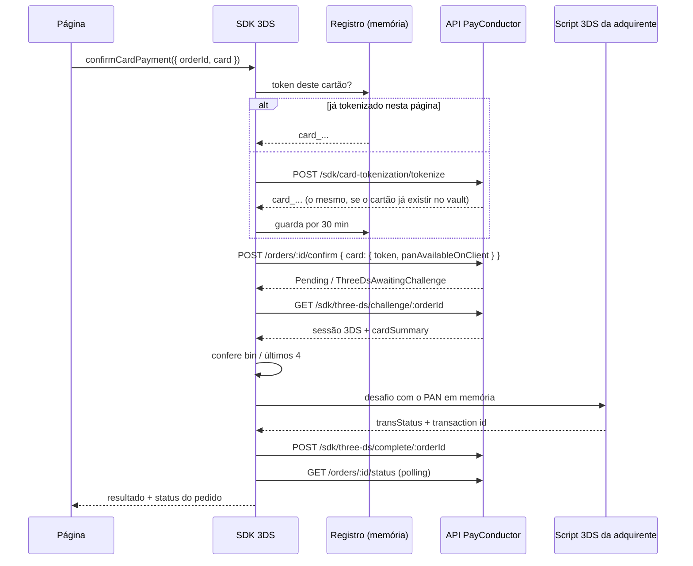

# PRD: vendas tokenizadas com 3DS

> Proposta para aprovação do tech lead.
> Escopo: SDK Web (`payconductor-sdk-web`) e monorepo (`pay.conductor`: `server`, `shared`, `iframe`, `link`).

## Resumo

Hoje uma venda com cartão tokenizado não passa por 3DS. O bloco 3DS do fluxo vê `card.token` e segue direto pela saída de sucesso, então a cobrança sai sem autenticação mesmo com 3DS configurado no fluxo. É por isso que o checkout hospedado tokeniza o cartão e descarta o token: se usasse o token, perderia o 3DS.

A correção tem duas metades. No backend, o 3DS passa a buscar o PAN no vault quando o pagamento chega com token. No browser, o SDK de 3DS continua sendo a única fonte do PAN para as adquirentes que fazem o desafio no front (Pagar.me/Stone e PagSeguro). Ele recebe o cartão completo, no mesmo formato do Tokenizer, e reaproveita o token que já existir em vez de gerar outro. Quando o pedido ainda não tem cartão, o próprio SDK de 3DS chama o Tokenizer (`confirmCardPayment`), e o dev resolve pagamento e 3DS numa chamada só.

O PAN nunca volta do backend para o browser. Isso não muda.

## Contexto

### O que o código faz hoje

| # | Onde | O que acontece |
|---|------|----------------|
| 1 | `server/.../routing-processor/nodes/three-ds/index.ts:76-82` | `if ("token" in payment.card)` segue por sucesso sem autenticar (log `three-ds:execute:tokenized-card-skipped`). |
| 2 | mesmo arquivo, `:325-328` | `buildAuthContext` devolve `card: undefined` para token. O Lyra (agnóstico) e a elegibilidade da Pagar.me dependem do número do cartão. |
| 3 | `server/.../pagar-me/utils/three-ds.ts:13-15` | Sem `card`, a Pagar.me vira `NotEnrolled` com "O 3DS da adquirente não aceita cartão tokenizado". |
| 4 | `server/src/services/three-ds/service.ts:524-554` | `GET /sdk/three-ds/challenge/:orderId` devolve sessão, cliente, valor e endereço. Não devolve cartão, e é assim que tem que ser. |
| 5 | SDK `three-ds/types.ts:56` | `ThreeDSecureInit.card` é opcional e não tem `cvv`. Sem ele, os providers da Pagar.me e do PagSeguro falham com `Missing card data`. |
| 6 | SDK `three-ds/handler.ts:121-140` | Essa falha vai para o `complete` como falha técnica, e o backend recusa a venda (fail-closed). Ou seja: o dev esquece o `card` e quem perde a compra é o comprador. |
| 7 | `shared/src/checkout/lib/payment-methods/credit-card/index.ts:36-64` | O checkout tokeniza, guarda em `_cardToken` e não usa. O `return` com token está comentado e o pedido vai com o cartão completo. |
| 8 | SDK `tokenizer/handler.ts:13-48` | Toda chamada cria token no PayConductor, busca `settings` e gera o token de frente (MercadoPago) de novo. Não tem reuso no browser. |
| 9 | `server/src/services/card/service.ts:203-227` | `saveFrontTokens` faz `insert` puro. Tokenizar o mesmo cartão duas vezes duplica linhas em `customerCardAcquirerTokens`. |
| 10 | `server/.../card-token-processor/index.ts:39-59` | O backend já deduplica o cartão por `cardHash` + cliente e devolve o mesmo `card_...`. Essa parte está pronta. |
| 11 | mesmo arquivo, `:61-114` | Quando o cartão já existe, o CVV não é regravado no cache (`tempCvvEncrypted`, 30 min). Só cartão novo grava o CVV. |
| 12 | `server/.../dto/full-order.ts:926` | O `creditCard.cardToken` do pedido sai de `customerCardId` (id interno), não do `token` público `card_...` que o Tokenizer devolve. Hoje não dá para comparar os dois. |

### Quem precisa do PAN no browser

| Provider | Modo | Onde o 3DS roda | PAN no browser? |
|----------|------|-----------------|-----------------|
| Lyra | `Agnostic` | servidor; o browser só abre o `operationUrl` | Não. O servidor precisa, e o vault resolve. |
| MercadoPago | `Auto` | na cobrança, com o token do MP | Não |
| Pagar.me / Pagar.me Split | `Manual` | `TDS.init` da Stone | Sim |
| PagSeguro | `Manual` | `PagSeguro.authenticate3DS` | Sim |
| Sandbox | `Manual` | modal simulado | Não |

Pagar.me e PagSeguro, as duas integrações reais de 3DS nativo no browser, precisam do PAN no front. Qualquer adquirente nova nesse modelo vai cair no mesmo caso, então o SDK precisa tratar isso como regra.

Por isso o backend sozinho não fecha a conta. Ele resolve o Lyra (busca o PAN no vault e autentica no servidor), mas no modo `Manual` o script da adquirente roda no browser e pede o número. A única origem aceitável desse número é o que o comprador acabou de digitar.

## Objetivos

- Venda tokenizada passa pelo bloco 3DS do mesmo jeito que a venda com cartão completo.
- Nenhuma resposta da API devolve PAN.
- Na mesma página, um cartão gera um token. Chamar o Tokenizer de novo reaproveita.
- O dev monta o objeto do cartão uma vez e passa o mesmo objeto para o Tokenizer e para o 3DS.
- Erro de integração (cartão faltando, cartão trocado) não recusa a venda do comprador.

Fora de escopo nesta entrega: one-click/upsell com cartão salvo sem o comprador digitar nada (ver perguntas em aberto), mudanças na `ThreeDSAcceptancePolicy` e network tokens.

## Regras que não mudam

- O PAN sai do browser para dois lugares: a API do PayConductor (tokenização ou confirmação) e o script 3DS da adquirente.
- Nada de cartão em `localStorage` ou `sessionStorage`. Recarregou a página, digita de novo.
- Falha reportada pelo browser durante o desafio continua fail-closed, como decidido no PRD do 3DS da Pagar.me (o comprador controla o browser e poderia forjar falha técnica para pular o 3DS). A diferença é que erro de integração detectado antes de abrir o desafio não chama `complete`.

## Fluxos que precisamos cobrir

### A. Backend do lojista cria o pedido com token

O front tokeniza (manualmente, com o Tokenizer), o backend do lojista cria o pedido com `card: { token }` e o front roda o 3DS. É o caso do `TokenizerDirectExample` com 3DS no final. Aqui o requisito é reaproveitar o token e não tokenizar de novo.

### B. Pedido criado sem pagamento, confirmado pelo browser

O lojista cria o pedido e o browser confirma via `POST /orders/:id/confirm?publicKey=`. É o que `iframe` e `link` já fazem com cartão completo. Aqui entra a auto-tokenização: o pedido ainda não tem cartão, então o SDK tokeniza (ou reaproveita), confirma com o token e roda o 3DS.

### C. Backend do lojista cria o pedido com cartão completo

Fluxo legado, funciona hoje. O SDK só precisa do cartão para o desafio. Não há o que tokenizar.

### D. Cartão salvo, sem PAN no browser

One-click e upsell. O 3DS `Manual` não tem como rodar. Fica fora desta entrega, mas a mudança do backend não pode travar esses pedidos (ver fase 0).

## Proposta

### Fase 0: backend (monorepo)

1. Tirar o atalho do token no `ThreeDSNode`. Quando o pagamento vier com token, `buildAuthContext` resolve o PAN pelo vault (`CardEncryptedPan.getEncryptedPanByCustomerCard`, o mesmo usado em `convertTokenToAcquirerPayload`) e o nome e a validade pelo `customerCards`. Isso fica só no servidor. Com isso o Lyra autentica cartão tokenizado e a elegibilidade da Pagar.me para de dar `NotEnrolled`.
2. Não travar o fluxo D. Sem um sinal de que o browser tem o cartão, um pedido de one-click num fluxo com Pagar.me ficaria `ThreeDsAwaitingChallenge` por 30 minutos esperando um desafio que ninguém consegue abrir. Proposta: token sem sinal usa só o modo `Agnostic` (o Lyra abre o desafio sem PAN no browser) e, se não houver agnóstico, segue como hoje (`NotEnrolled`). Os modos `Manual` só entram quando o pedido disser que o browser tem o cartão, com um campo opcional no cartão do pedido (nome a definir, ex.: `card.panAvailableOnClient`). No fluxo B o SDK manda esse campo sozinho. No fluxo A, o lojista manda.
3. Expor um resumo do cartão no desafio. `GET /sdk/three-ds/challenge/:orderId` passa a devolver `cardSummary: { token, bin, lastFour, brand }`. O PCI permite exibir os 6 primeiros e os 4 últimos dígitos. O nome não pode ser `card`: o SDK faz `{ ...this.data, ...fullData }` e um `card` vindo da API sobrescreveria o cartão que o dev passou.
4. Alinhar o `cardToken` do pedido com o `token` público (`card_...`) que o Tokenizer devolve (item 12).
5. `saveFrontTokens` idempotente: upsert por `(customerCardId, integrationId)` em vez de `insert`.
6. Tokenização de cartão existente devolve `isNewToken` (o `CardTokenProcessor` já calcula e não expõe) e regrava o CVV no cache.

### Fase 1: SDK

#### Um formato de cartão

O 3DS passa a aceitar o mesmo `CreateCardInput` do Tokenizer (`number`, `holderName`, `expiration`, `cvv`). Não aceita token nem cartão mascarado. Hoje o checkout tem um `toThreeDSecureCard` só para converter de um formato para o outro (`shared/src/checkout/utils/card.ts:16`); ele deixa de ser necessário.

#### Registro de tokens em memória

Um mapa compartilhado entre Tokenizer e 3DS:

- chave: SHA-256 (`crypto.subtle`) de `publicKey + PAN + mês + ano`;
- valor: a `Promise` de `{ token, customerId }`, para que um duplo clique use a mesma tokenização em andamento;
- validade de 30 min, a mesma do CVV no cache e do payload do cartão no Redis do 3DS;
- fica em `globalThis` sob `Symbol.for("payconductor.cardTokens")`, porque no CDN `payconductor-3ds.js` e `payconductor-tokenizer.js` são IIFEs separadas e não compartilham módulo;
- não guarda PAN nem CVV, e não vai para storage nenhum;
- o token é por cliente no backend (a busca do token de adquirente filtra pelo `customerId` do pedido), então só reaproveita se o cliente for o mesmo.

O `tokenizeCard` consulta o registro antes de chamar a API e grava depois. Também vale guardar o `GET /sdk/card-tokenization/settings` por `publicKey`, que hoje é buscado a cada chamada.

#### `authenticate()` com o cartão

A assinatura continua `new PayConductor3DSSDK({ orderId, publicKey, card }).authenticate()`. Por dentro:

1. Busca o desafio, como hoje.
2. Cada provider declara se precisa do PAN (`requiresCard`: Pagar.me e PagSeguro). Se precisa e o `card` não veio, devolve `Failed` com código `CardRequired` sem chamar `complete`. O desafio continua pendente e o dev pode tentar de novo dentro dos 30 minutos.
3. Se veio `cardSummary`, confere bin e últimos 4 com o cartão recebido. Se não bater, `CardMismatch`, também sem `complete`. Quando o registro conhece o token deste cartão, a comparação é com o token, que é exata.
4. Não tokeniza. No fluxo A o token já existe no pedido e no fluxo C o backend já tem o cartão. Tokenizar de novo só gasta chamada.
5. Abre o desafio com o PAN em memória, manda `complete` e faz polling, como hoje.

Junto vai uma correção: hoje `authenticate()` num pedido sem desafio volta `Failed`, porque o `GET` do desafio responde 400 (`handler.ts:57-67`). Ele deveria devolver `Success` com o status do pedido. Assim o dev nem precisa chamar `requiresChallenge` antes.

### Fase 2: auto-tokenização e checkout hospedado

#### `confirmCardPayment`

É aqui que o SDK de 3DS chama o Tokenizer:

```ts
const result = await PayConductor3DSSDK.confirmCardPayment({
	publicKey,
	orderId, // pedido criado sem pagamento
	card,
	installments: 1,
});

result.order?.status; // Succeeded | Pending | Failed
```

Também exposto no `useThreeDS`. O que acontece por dentro:



Falta resolver de onde vem o cliente da tokenização nesse fluxo (pergunta 3).

#### Checkout hospedado

`shared` passa a usar `confirmCardPayment` (ou o token, no mínimo) e o `return` comentado em `credit-card/index.ts` volta. `iframe` e `link` param de montar tokenização, confirmação e 3DS na mão.

## Como fica para o dev

Fluxo A depois da fase 1. É o mesmo código de hoje, mas sem tokenização duplicada, com o cartão no mesmo formato e com conferência do cartão:

```ts
const card = { number, holderName, cvv, expiration: { month, year } };

const token = await new PayConductorTokenizerSDK(publicKey).tokenizeCard({ card, customer });
const order = await meuBackend.criarPedido({ card: { token, panAvailableOnClient: true } });

const result = await new PayConductor3DSSDK({ orderId: order.id, publicKey, card }).authenticate();
```

Fluxo B depois da fase 2: uma chamada, o `confirmCardPayment` acima.

## Erros e casos de borda

| Situação | O que o SDK faz | Chama `complete`? |
|----------|-----------------|-------------------|
| Provider precisa do PAN e o `card` não veio | `Failed`, `CardRequired` | Não. O desafio continua pendente. |
| Bin ou últimos 4 diferentes do pedido | `Failed`, `CardMismatch` | Não |
| Pedido sem desafio pendente | `Success` com o status do pedido | Não |
| Tokenização falhou no `confirmCardPayment` | erro antes de confirmar; o pedido segue sem pagamento | Não |
| Comprador cancelou ou o emissor negou | como hoje | Sim (fail-closed) |
| Mais de 30 min entre tokenizar e cobrar | registro expira e tokeniza de novo (o backend devolve o mesmo `card_...` e regrava o CVV, item 6 da fase 0) | n/a |
| Mais de 30 min com o desafio aberto | como hoje: o backend falha a cobrança com `ThreeDSVerificationFailed` | n/a |
| Página recarregada | registro some, o comprador digita de novo | n/a |

Os códigos novos entram em `ERROR_CODES` e saem no `PayConductorThreeDSApiError`, seguindo o padrão do repo.

## Segurança e PCI

- Hash de PAN sem chave é fraco, porque o espaço de PANs é pequeno. O registro fica só em memória, mistura a `publicKey` e nunca é logado.
- A conferência de bin/últimos 4 ajuda na integração e não serve de controle de segurança, porque o comprador controla o browser. Quem amarra autenticação e cobrança é a adquirente, pelo `transaction_id` da Stone ou pelo `id` do PagSeguro. Isso precisa ser confirmado com elas (pergunta 6).
- Logs com prefixo `[PayConductor]`, só com `debug` ligado, sem dado de cartão.
- O escopo PCI do lojista não muda. Quem usa o SDK headless já tem o PAN no próprio JS. Quem quer tirar o PAN da sua página usa o elemento de checkout (iframe), que na fase 2 passa a usar token e 3DS por dentro.

## Compatibilidade e release

- Exigir `cvv` no cartão do 3DS e tornar o `card` obrigatório quebra o tipo para quem só usa Lyra ou MercadoPago. Recomendo publicar na linha 1.x com `card` opcional no tipo, já no formato completo, e `CardRequired` em runtime. Obrigatório de verdade no 2.0.
- `cardSummary` e `panAvailableOnClient` mudam o contrato compartilhado: depois do deploy do monorepo, rodar `bun sync` aqui para atualizar `iframe/types.ts`.
- APIs novas exportadas em `library/v1/src/index.ts`. As entradas de `src/esm/*` continuam só registrando globais.
- O CDN só publica com bump de versão no `package.json` da raiz.
- Ordem de deploy: fase 0 no backend, publicar `@payconductor/react`, `bun update @payconductor/react` em `shared`, `iframe` e `link`, e só então ligar o token no checkout. Sem o `cardSummary` o SDK pula a conferência e segue funcionando, então as fases 0 e 1 podem ser desenvolvidas em paralelo.

## Critérios de aceite

- [ ] Pedido com `card.token` (e `panAvailableOnClient`) num fluxo com Pagar.me abre o desafio no browser e cobra com `mpi: pagarme` depois de `Y` ou `A`.
- [ ] O mesmo com PagSeguro.
- [ ] Pedido com `card.token` num fluxo com Lyra autentica sem PAN no browser.
- [ ] Pedido com `card.token` sem `panAvailableOnClient` e sem agnóstico disponível segue como hoje e não fica preso em `ThreeDsAwaitingChallenge`.
- [ ] Dois `tokenizeCard` com o mesmo cartão na mesma página fazem uma chamada à API e não duplicam `customerCardAcquirerTokens`.
- [ ] `authenticate()` depois de `tokenizeCard()` não chama a tokenização.
- [ ] `authenticate()` sem `card` num pedido Pagar.me devolve `CardRequired`, não chama `complete` e o pedido continua aguardando o desafio.
- [ ] Cartão com últimos 4 diferentes devolve `CardMismatch` antes de abrir o desafio.
- [ ] `authenticate()` em pedido sem desafio devolve o status do pedido.
- [ ] `payconductor-3ds.js` e `payconductor-tokenizer.js` na mesma página compartilham o registro.
- [ ] Nenhuma resposta da API contém PAN e nenhum log do SDK contém dado de cartão.
- [ ] `iframe` e `link` enviam token e passam pelo 3DS.

Este repo não tem test runner. A validação do SDK é `bun run build` e `npm run lint` em `library/v1`, build de `packages/react` e a matriz acima rodada à mão num exemplo novo em `examples/react` (tokenização + 3DS). Lembrete do PRD anterior: o sandbox da Stone recusa `requestor_url` em `localhost`, então o teste com Pagar.me precisa de domínio público.

## Perguntas em aberto

1. Nome e semântica do sinal do fluxo D. `panAvailableOnClient` no cartão do pedido resolve? Prefiro o default seguro (sem o campo, `Manual` não entra) a arriscar travar one-click. O lado ruim é que o lojista do fluxo A precisa lembrar de mandar o campo para ter 3DS da Pagar.me.
2. Breaking change. 1.x com `CardRequired` em runtime agora e obrigatório no 2.0, ou direto para 2.0?
3. Cliente na tokenização do `confirmCardPayment`. O backend já aceita `customer: { id }` em `GetOrCreateCustomer`, mas o SDK não conhece esse id. Opções: a tokenização aceitar `orderId` e resolver o cliente pelo pedido, ou o pedido expor `customerId`. Prefiro `orderId`, para o SDK não lidar com id de cliente.
4. Token de frente do MercadoPago. O card token do MP é de uso único. Reaproveitar o `card_...` não pode significar reaproveitar um token MP já consumido numa cobrança anterior. Quem decide quando gerar um novo: o SDK (pelo `isNewToken`) ou o backend (dizendo quais integrações estão sem token válido)?
5. CVV de cartão já existente. Regravar o CVV no cache a cada tokenização (item 6 da fase 0)? Sem isso, a cobrança depois do 3DS de um cartão que já estava no vault pode sair sem CVV.
6. Amarração entre autenticação e cobrança. A Pagar.me e o PagSeguro recusam um `transaction_id` gerado para outro cartão? Se não, vale conferir no servidor também (o `complete` levar o token e o backend comparar com o do pedido).

## O que descartamos

- Backend devolver o PAN no desafio. É justamente o que não podemos fazer.
- Guardar o cartão no `sessionStorage` para sobreviver a reload. Seria armazenar dado de cartão no browser. Reload pede o cartão de novo.
- Tokenizar sempre dentro do `authenticate()`. Quando o pedido já tem token, o backend já tem o cartão no vault. Tokenizar de novo só custa chamadas e hoje ainda duplica tokens de adquirente. A auto-tokenização fica no `confirmCardPayment`, onde o pedido ainda não tem cartão.
- Conferir o cartão tokenizando e comparando tokens. É exato, mas custa uma chamada e mexe no vault. Bin e últimos 4 pegam o erro comum (cartão errado, campo editado depois de criar o pedido) sem chamada nenhuma. Quando o registro já tem o token, a comparação exata sai de graça.

Para depois: `onCardRequired` no 3DS para pedir o cartão de novo no one-click, e campos de cartão hospedados (iframe por campo) para quem quer UI própria sem o PAN no JS da página.
